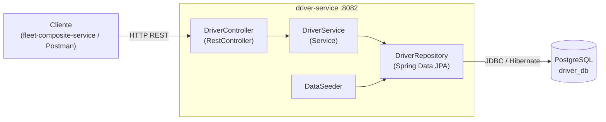
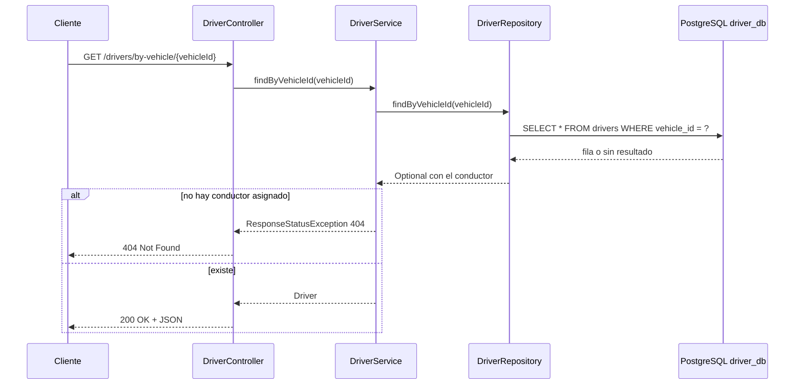

# driver-service

Microservicio de gestión de conductores: perfil del operador, licencia vigente, calificación de seguridad y certificaciones. Base de datos propia `driver_db`.

**Stack:** Java 17 · Spring Boot 3.3 · Maven · PostgreSQL  
**Puerto:** 8082

## Endpoints

| Método | Ruta | Descripción |
|---|---|---|
| GET | `/drivers` | Lista todos los conductores |
| GET | `/drivers/{id}` | Obtiene un conductor (404 si no existe) |
| GET | `/drivers/by-vehicle/{vehicleId}` | Conductor asignado a un vehículo (404 si no hay) |
| POST | `/drivers` | Crea un conductor (201 + Location) |

## Modelo (`drivers`)

`id`, `fullName`, `licenseCategory`, `licenseExpiration`, `safetyScore`, `safetyCertifications`, `vehicleId`, `assignmentId`


## Cómo ejecutarlo

```bash
# Antes: CREATE DATABASE driver_db;  (desde psql)
mvn spring-boot:run
```

## Diagramas

Los diagramas editables en draw.io están en `docs/driver-service-diagramas.drawio` (páginas: componentes y secuencia).
Las mismas vistas en Mermaid (se renderizan directo en GitHub):

### Componentes



### Secuencia


